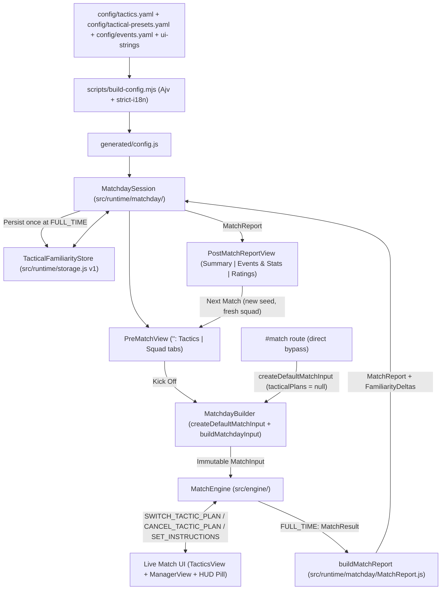

# Football Manager Matchday Loop (Phase 1)

* **Author:** bytemania
* **Status:** Approved
* **Date:** 2026-11-25
* **Predecessor Brief:** [matchday-loop-phase1-brief.md](./matchday-loop-phase1-brief.md)

---

## The Problem

Today, opening `freefoot` drops the player straight into an already-started match with fixed sample squads, a default `4-3-3` shape, and no way to prepare before kickoff or review what happened after full time.

This creates four gaps in the core football-management experience:

1. **No pre-match preparation.** Players cannot choose their starting XI, arrange their 7-man bench, inspect how their squad fits a shape, or pick a tactical identity before kickoff.
2. **Narrow tactical identity.** Only two formations (`4-3-3` and `4-4-2`) exist, and the nine team instructions must be configured one slider at a time during live play instead of starting from recognizable tactical styles (such as Gegenpress, Tiki-Taka, or Low Block).
3. **No cost or payoff for tactical preparation.** Switching shapes or rewriting instructions mid-match carries no familiarity trade-off. A player can jump from balanced football to an aggressive high press at zero penalty, and playing a style repeatedly builds no team cohesion across matches.
4. **Dead-end full time.** At full time, the match stops with a basic modal and a reload button. There is no post-match summary (scorers, Man of the Match, key events with VAR reversals, player ratings, and tactical familiarity gains) and no structured `MatchReport` contract for a future Career Mode.

---

## Overview

Phase 1 connects `freefoot` into a complete, repeatable matchday loop on mobile portrait and desktop screens:

**Pre-Match Setup -> Live Match (Plan A / Plan B Switching) -> Post-Match Report -> Next Match**

* **Pre-Match Setup (`""` root route):** Players browse a library of 10 default tactics (each pairing a formation with a distinct profile built from the existing 9 team instructions), inspect their squad's familiarity with each tactic, assign two matchday slots (**Plan A** as primary and **Plan B** as backup), select their Starting XI and 7-man bench on a mini-pitch with a Plan A/B preview toggle, and kick off. Direct entry to a live match remains available via `#match` so developer workflows and existing automated tests keep working.
* **Tactical Familiarity (0–100%):** Each tactic's familiarity combines **60% formation familiarity** and **40% instruction familiarity**, saved across matches so tactical choices carry consequences from one match to the next. Well-drilled tactics (`80–100%`, Fluid) play with zero penalty; less drilled tactics (`50–79%`, Competent; `0–49%`, Unfamiliar) introduce increasing decision-making error and, below 50%, extra fatigue. Both formation and instruction slices must reach at least `65%` before a tactic unlocks Fluid status, preventing an unused instruction style from becoming Fluid solely because its formation is mastered.
* **Live Plan A / Plan B Switching:** During the match, the Tactics drawer centers on the two prepared matchday plans (Plan A and Plan B) with their live familiarity percentages. Switching plans queues a tactical change for the next stoppage and automatically remaps the on-pitch players (including `<11`-player states after red cards) to their best-fitting roles. Manual instruction tweaks remain available underneath, but deviating from the active plan's trained profile reduces live instruction familiarity and marks the plan `Modified` (with a live preview and one-tap reset).
* **Post-Match Report & Loop:** At full time, a post-match projection layer outside `src/engine/` summarizes the match into a serializable `MatchReport` contract (final score and scorers, Man of the Match, VAR-reconciled key events timeline, team stats, player ratings, and Plan A/B familiarity progression) across a three-tab report screen, followed by a `Next Match` action that starts a fresh match while carrying tactical familiarity and Plan A/B selections forward.

Including the 10-tactic library, Plan A/B slots, and familiarity model in Phase 1 establishes the core data contracts planned for Phase 2 Career Mode, while excluding unbacked engine mechanics (extra time, penalty shootouts, phase-lag physics, and custom reduced formations).

---

## Goals

1. **Complete Matchday Loop:** Deliver the full Pre-Match -> Live Match -> Post-Match Report -> Next Match user journey on the default route (`""`) while preserving `#match` as a direct-entry bypass, `#seed=...` for the debug viewer, and `#bench` for benchmarks.
2. **10 Default Tactics:** Provide 10 default tactical presets (`balanced`, `gegenpress`, `tiki-taka`, `vertical-tiki-taka`, `control-possession`, `wing-play`, `fluid-counter`, `direct-counter`, `route-one`, `low-block`) spanning 7 new 11-player formations plus the existing `4-3-3` and `4-4-2`, using the existing 6 engine roles (`GK, CB, FB, MF, W, ST`) and existing `emergencyShape` 10/9-player fallbacks.
3. **Transparent Familiarity Model:** Implement the 60/40 formation-and-instruction familiarity model (with the `< 65` minimum-part Fluid cap, `-12` per manually overridden instruction, bounded `noiseMul`/`drainMul` penalties, live delta preview, and continuous post-match progression persisted via `capacitorStorage()`).
4. **Reliable Mid-Match Plan Switching:** Support queued `SWITCH_TACTIC_PLAN` and `CANCEL_TACTIC_PLAN` commands through the deterministic command log, composing atomically after queued substitutions at the stoppage, reusing the existing Hungarian optimal role-assignment solver (verified for `<11` players and acting goalkeepers after a GK red card), and surfacing a cancelable HUD pill while queued.
5. **Career-Ready `MatchReport` Contract & Pure Engine Boundary:** Keep career and pre-match storage strictly outside `src/engine/`, passing only an immutable match-input snapshot in and deriving `MatchReport` externally in `src/runtime/matchday/` from `MatchResult` (reusing existing engine player ratings `p.rating`).
6. **Zero Regression & Full Quality Gates:** Keep `tests/golden/seeds.json` untouched (matches where `tacticalPlans === null` emit no new fields in `MatchState.serialize()`, and `>= 80%` Fluid familiarity applies no engine knob modifiers), maintain full `en-GB` and `pt-PT` strict i18n parity using the repo's flat 2-level key convention, keep `H1/H2` labels intact, and pass `npm run build:config`, `npm test`, `npm run test:coverage` (`>= 85%` line coverage on `src/engine/**` and `src/runtime/**`), `npm run lint`, `npm run typecheck`, `npm run build`, and `npm run test:e2e`.

---

## Non-Goals

1. **Career / Season Meta-Game (Phase 2):** No calendar, fixtures, league tables, training schedules, transfers, or multi-match fatigue, injury, and suspension carryover. `Next Match` resets squad fitness, cards, and injuries to fresh matchday defaults.
2. **Extra Time, Penalty Shootouts, and Period Renaming:** `MatchClock.js` models two halves (`HALF_TIME` and `FULL_TIME`). Extra time (`EX1/EX2`), penalty shootouts (`PEN`), knockout toggles in Pre-Match, and renaming `H1/H2` to `P1/P2` are excluded from Phase 1.
3. **New Engine Roles, Instructions, or Phase Physics:** No changes to `config/roles.yaml` (stays at 6 roles), no new team instructions (no always-on pressing or out-of-possession width), no new `Phase.js` transition-lag mechanics, and no custom 10-player/9-player `reducedTo` shapes for the 7 new formations (`emergencyShape` is used for 10/9 players).
4. **AI Manager Tactical Switching or Familiarity Penalties:** In Phase 1, the AI opponent selects a tactic from the 10-tactic library deterministically from the match seed, aligns its XI to that formation before kickoff, plays with no familiarity penalties, and does not switch between Plan A and Plan B. (Note for Phase 2: `src/engine/ai/AiCoach.js` currently emits raw `SET_FORMATION`, which works in Phase 1 because AI teams omit `tacticalPlans`; if AI teams receive `tacticalPlans` in Phase 2, `AiCoach.js` must switch to `SWITCH_TACTIC_PLAN`.)
5. **Duplicate Player Rating Formula:** No second rating algorithm outside `src/engine/`; the existing deterministic `Rating.js` calculation (`p.rating`) is exposed via `MatchResult.players`.
6. **Sample Squad Modifications:** `config/squads/sample-home.yaml` and `sample-away.yaml` already include 3 CBs each and remain untouched to protect golden determinism.

---

## Technical Plan

### Architecture Overview & Data Flow

The design enforces a strict boundary between outer matchday state (`src/runtime/matchday/` + `src/ui/`) and the deterministic simulation engine (`src/engine/`). Career and pre-match storage never enter `src/engine/`. Instead, the matchday layer builds an immutable `MatchInput` (carrying optional `tacticalPlans`), passes it to `MatchEngine.create()`, and projects `MatchResult` into a `MatchReport` after `FULL_TIME`.



---

### 1. Config, Schemas, Events, and Flat 2-Level i18n Pipeline

#### 1.1 Seven New Formations (`config/tactics.yaml` & `config/schema/tactics.schema.json`)

* Widen `formations.propertyNames.pattern` in `config/schema/tactics.schema.json` from `^[0-9](-[0-9]){2,3}$` to `^[0-9](-[0-9]){2,4}$` (all 9 11-player formations, including `4-1-2-1-2`, are purely numeric; `reducedTo` and `emergencyShape` keep `{2,3}` in Phase 1).
* Leave existing `4-3-3`, `4-4-2`, `4-3-2`, `4-4-1`, `4-3-1`, and `emergencyShape` untouched so golden seeds stay bit-identical.
* Coordinates use normalized pitch fractions from the team's own perspective: `x` runs from own goal (`0.0`) to opponent goal (`1.0`), and `y` runs left touchline (`0.0`) to right touchline (`1.0`). Each slot specifies `defend` and `attack` base anchors, `follow` (ball-tracking factors `[fx, fy]`), and `pressZone`/`markZone` radii in metres.
* Every new formation sets `reducedTo: {}` (falling back to `emergencyShape` for 10/9 players). Slots are listed goalkeeper first, then back to front, left to right, scaled to match `4-3-3`/`4-4-2` and aligned with `src/ui/positions.js` thresholds (`DM`/`MDC`: `MF` with `x < 0.33` and `0.36 <= y <= 0.64`; `AM`/`MO`: `MF` with `x >= 0.45`; `LWB`/`RWB` (`AE`/`AD`): `FB` with `x >= 0.32`):

| Formation | 11 Slots — `role (defend x, y) -> positionCode()` |
| :--- | :--- |
| `4-2-3-1` | GK (.04,.50) GK · FB (.24,.14) LB · CB (.20,.38) CB · CB (.20,.62) CB · FB (.24,.86) RB · MF (.31,.38) DM · MF (.31,.62) DM · W (.48,.16) LW · MF (.48,.50) AM · W (.48,.84) RW · ST (.55,.50) ST |
| `4-1-2-1-2` | GK (.04,.50) GK · FB (.24,.14) LB · CB (.20,.38) CB · CB (.20,.62) CB · FB (.24,.86) RB · MF (.30,.50) DM · MF (.40,.32) LCM · MF (.40,.68) RCM · MF (.49,.50) AM · ST (.55,.38) ST · ST (.55,.62) ST |
| `4-1-4-1` | GK (.04,.50) GK · FB (.24,.14) LB · CB (.20,.38) CB · CB (.20,.62) CB · FB (.24,.86) RB · MF (.30,.50) DM · W (.44,.14) LM · MF (.41,.36) CM · MF (.41,.64) CM · W (.44,.86) RM · ST (.55,.50) ST |
| `3-5-2` | GK (.04,.50) GK · CB (.20,.28) CB · CB (.19,.50) CB · CB (.20,.72) CB · FB (.34,.12) LWB · MF (.31,.50) DM · MF (.42,.34) LCM · MF (.42,.66) RCM · FB (.34,.88) RWB · ST (.55,.38) ST · ST (.55,.62) ST |
| `3-4-3` | GK (.04,.50) GK · CB (.20,.28) CB · CB (.19,.50) CB · CB (.20,.72) CB · FB (.35,.12) LWB · MF (.38,.38) CM · MF (.38,.62) CM · FB (.35,.88) RWB · W (.50,.18) LW · ST (.55,.50) ST · W (.50,.82) RW |
| `4-2-4` | GK (.04,.50) GK · FB (.24,.14) LB · CB (.20,.38) CB · CB (.20,.62) CB · FB (.24,.86) RB · MF (.38,.38) CM · MF (.38,.62) CM · W (.50,.16) LW · ST (.55,.38) ST · ST (.55,.62) ST · W (.50,.84) RW |
| `5-4-1` | GK (.04,.50) GK · FB (.24,.12) LB · CB (.19,.30) CB · CB (.18,.50) CB · CB (.19,.70) CB · FB (.24,.88) RB · W (.38,.16) LM · MF (.34,.38) CM · MF (.34,.62) CM · W (.38,.84) RM · ST (.52,.50) ST |

* Derived `attack`, `follow`, `pressZone`, and `markZone` fields match existing `4-3-3`/`4-4-2` role defaults (`attack.y = defend.y`, except `FB`, wing-back, and `W` move `0.02` closer to the nearest touchline):

| Role / Band | `attack.x` = `defend.x` + | `follow` | `pressZone` / `markZone` |
| :--- | :--- | :--- | :--- |
| `GK` | `0.00` | `[0.08, 0.10]` | `0` / `0` |
| `CB` | `0.14` | `[0.25, 0.20]` | `10` / `10` |
| `FB` (`x < 0.32`) | `0.18` | `[0.30, 0.25]` | `12` / `10` |
| `FB` wing-back (`x >= 0.32`) | `0.20` | `[0.30, 0.25]` | `12` / `10` |
| `MF` as `DM` (`x < 0.33`) | `0.12` | `[0.40, 0.25]` | `14` / `12` |
| `MF` central/side (`0.33 <= x < 0.45`) | `0.15` | `[0.40, 0.30]` (`[0.40, 0.25]` if `y = 0.50`) | `14` / `12` |
| `MF` as `AM` (`x >= 0.45`) | `0.18` | `[0.40, 0.25]` | `14` / `12` |
| `W` wide mid (`x < 0.45`) | `0.22` | `[0.40, 0.30]` | `12` / `10` |
| `W` forward (`x >= 0.45`) | `0.28` | `[0.35, 0.30]` | `10` / `8` |
| `ST` | `0.30` | `[0.35, 0.20]` | `10` / `8` |

#### 1.2 Ten Default Tactical Presets (`config/tactical-presets.yaml` & `config/schema/tactical-presets.schema.json`)

* Keep managerial presets outside `config/tactics.yaml`. The file has three top-level keys (`additionalProperties: false`): `defaultSlots` (`{ planA: 'balanced', planB: 'wing-play' }`), `defaultFormations` (first-launch familiarity for all 9 11-player formations), and `presets` (10 entries of `{ id, formationId, instructions, defaultInstrFam }`).
* Instruction normalization (`normalizeInstructions`) fills any omitted key among the 9 instructions in `config/tactics.yaml` with that instruction's default option.

**First-launch `defaultFormations`:** `4-3-3: 90`, `4-4-2: 85`, `4-2-3-1: 60`, `4-1-4-1: 55`, `4-1-2-1-2: 50`, `5-4-1: 50`, `3-5-2: 45`, `3-4-3: 45`, `4-2-4: 45`.

| # | `id` | `formationId` | Non-default `instructions` | `defaultInstrFam` | Starting Effective / Tier |
| :- | :--- | :--- | :--- | :-: | :--- |
| 1 | `balanced` | `4-3-3` | `{}` | `90` | `90` (Fluid) |
| 2 | `gegenpress` | `4-2-3-1` | `{ tempo: fast, directness: direct, defensiveLine: high, defensiveTransition: counterPress, tackling: getStuckIn }` | `50` | `56` (Competent) |
| 3 | `tiki-taka` | `4-3-3` | `{ tempo: slow, directness: short, defensiveLine: high, defensiveTransition: counterPress }` | `50` | `74` (Competent) |
| 4 | `vertical-tiki-taka` | `4-1-2-1-2` | `{ tempo: fast, directness: short, attackFocus: center, defensiveLine: high }` | `45` | `48` (Unfamiliar) |
| 5 | `control-possession` | `4-1-4-1` | `{ tempo: slow, directness: short }` | `55` | `55` (Competent) |
| 6 | `wing-play` | `4-4-2` | `{ attackFocus: wings }` | `60` | `75` (Competent) |
| 7 | `fluid-counter` | `3-5-2` | `{ tempo: fast, attackTransition: counter }` | `50` | `47` (Unfamiliar) |
| 8 | `direct-counter` | `3-4-3` | `{ tempo: fast, directness: direct, attackTransition: counter, defensiveLine: low, defensiveTransition: regroup }` | `45` | `45` (Unfamiliar) |
| 9 | `route-one` | `4-2-4` | `{ tempo: fast, directness: direct, attackFocus: center }` | `40` | `43` (Unfamiliar) |
| 10 | `low-block` | `5-4-1` | `{ tempo: slow, attackFocus: center, defensiveLine: low, defensiveTransition: regroup }` | `50` | `50` (Competent) |

* **Build pipeline registration (`scripts/build-config.mjs`):**
  * Load `config/tactical-presets.yaml` conditionally via `existsSync()` (matching `shouts.yaml` and `var.yaml`) so minimal test fixtures in `tests/config/fixtures/` without presets keep passing.
  * When present: Ajv-validate against `tactical-presets.schema.json`; verify every preset's `formationId` and every `defaultFormations` key exists in `tactics.formations` with `slots.length === 11`; validate every preset's `instructions` against `tactics.instructions`; reject duplicate `(formationId, normalizedInstructions)` pairs; verify `defaultSlots.planA !== defaultSlots.planB` and both exist in `presets`; verify all required strings in `formations`, `tacticPresets`, `tacticPlan`, `preMatch`, `matchReport`, and the 5 new `errors` codes exist in every locale; and emit `tacticalPresets` on `config` in `generated/config.js`.
  * Guard the locale parity loop (`build-config.mjs:508-519`) symmetrically for missing optional groups (checking both `group in other` and extra groups in `other`) so an omitted optional group reports a clean config error instead of throwing `TypeError`.

#### 1.3 Event Metadata (`config/events.yaml`)

* Extend `FORMATION_CHANGE.meta` with optional keys `baseFormationId: string`, `plan: { type: string, values: [A, B] }`, and `tacticId: string`. Because `validateEvent()` (`src/engine/events/MatchEvent.js`) validates only keys present on an emitted event, existing `SET_FORMATION` events carrying `{ formationId }` stay valid and `{ debug: true }` runs validate `SWITCH_TACTIC_PLAN` emissions cleanly.

#### 1.4 Uniform Flat 2-Level i18n Groups (`config/ui-strings/*.yaml` & `config/schema/ui-strings.schema.json`)

* Match the codebase's existing 2-level `group.key` convention, requiring zero changes to `src/i18n/Locale.js`.
* Keep the 5 new groups and 5 new `errors` codes in `properties` (optional in `ui-strings.schema.json`, not in `required`, matching `tactics`/`shouts`/`var` so existing `tests/config/build.test.js` fixtures pass), and enforce their presence in `scripts/build-config.mjs` whenever `tactical-presets.yaml` exists.
* Define explicit `propertyNames.pattern` rules in `ui-strings.schema.json`:
  * `formations`: `^[0-9](-[0-9]){2,4}$` — all 9 11-player formation display labels (`4-1-2-1-2` -> `"4-4-2 Diamond"` / `"4-4-2 Losango"`, others match their numeric ID).
  * `tacticPresets`: `^[a-z][a-z0-9-]*(Hint)?$` — `<id>` and `<id>Hint` (concise trade-off summary joined by `" · "`, e.g., `"Patient short passing · fewer shots"`) for all 10 presets.
  * `tacticPlan`: `^[A-Za-z][A-Za-z0-9]*$` — `planA`, `planB`, `fluid`, `competent`, `unfamiliar`, `modified`, `resetToPlan`, `switchQueued` (`{plan}`), `cancelSwitch`, `familiarityPreview` (`{from}`, `{to}`), `formation`, `instructions`, `dropsTo` (`{tier}`), `partBelowMin` (`{part}`, `{min}`), `outOfPositionCount` (`{count}`).
  * `preMatch`: `^[A-Za-z][A-Za-z0-9]*$` — `title`, `tabTactics`, `tabSquad`, `assignPlanA`, `assignPlanB`, `previewPlanA`, `previewPlanB`, `startingXI`, `bench`, `autoPick`, `kickOff`, `planMustDiffer`, `inMatchNote`.
  * `matchReport`: `^[A-Za-z][A-Za-z0-9]*$` — `title`, `tabSummary`, `tabEventsStats`, `tabRatings`, `motm`, `keyEvents`, `noKeyEvents`, `familiarityGain`, `fluidUnlocked`, `gainMinutes` (`{n}`, `{minutes}`), `notUsed`, `colRating`, `colMinutes`, `colFitness`, `colCards`, `colInjury`, `nextMatchNote`, `nextMatch`.
  * `errors` (added to `errors.properties`): `NO_TACTIC_PLANS`, `UNKNOWN_PLAN`, `ALREADY_ACTIVE_PLAN`, `NO_PENDING_PLAN_SWITCH`, `USE_TACTIC_PLAN`.
* Use sentence case in `en-GB` (proper terms like `Plan A`, `Starting XI`, `Man of the Match` keep capitals) with exact `pt-PT` parity. Leave `stats.header` (`{minute} · H{half}`) and `ScoreboardView.js` untouched.

---

### 2. Engine Familiarity, Knob Composition, and Serialization

#### 2.1 Immutable Match-Input Snapshot (`src/engine/contracts/MatchInput.js`)

* Add optional `tacticalPlans` to `InputTeam` (keeping `MatchInput.v === 1` backward-compatible):
  ```ts
  interface TacticalPlanSlot {
    tacticId: string;                     // non-empty string
    formationId: string;                  // must exist in formations with slots.length === 11
    instructions: Record<string, string>; // validated against config.tactics.instructions
    formFam: number;                      // finite 0..100
    instrFam: number;                     // finite 0..100
  }
  interface TeamTacticalPlans {
    planA: TacticalPlanSlot;
    planB: TacticalPlanSlot;
  }
  ```
* `validateMatchInput()` enforces consistency invariants when `tacticalPlans` is present:
  * `planA.formationId === team.formationId`, and normalized `planA.instructions` equals normalized `team.instructions`.
  * `planA.tacticId !== planB.tacticId`, both `tacticId`s are non-empty strings.
  * Both `formationId`s exist in `config.tactics.formations` with `slots.length === STARTERS` (11).
  * Both `instructions` maps pass `validateInstructions()`, and all four familiarity values are finite numbers in `0..100`.
* `MatchState` deep-clones and freezes `tacticalPlans` onto static team data (`team.tacticalPlans`, `null` when omitted) so external mutation after `MatchEngine.create()` cannot affect replays.

#### 2.2 Pure Familiarity Module (`src/engine/tactics/Familiarity.js`)

* Pure, deterministic module with zero import dependency on `Instructions.js` (keeping the import graph strictly acyclic: `Instructions.js -> Familiarity.js`):
  * `countInstructionDeviations(instrCfg, activeInstructions, trainedInstructions)`: compares each of the 9 keys in `instrCfg` directly (falling back to `instrCfg[id].default` when omitted) and returns `0..9`.
  * `deriveEffectiveFamiliarity(instrCfg, plan, activeInstructions)`:
    1. `changed = countInstructionDeviations(instrCfg, activeInstructions, plan.instructions)`
    2. `instrFamLive = max(0, plan.instrFam - 12 * changed)`
    3. `raw = clamp(0, 100, round(0.6 * plan.formFam + 0.4 * instrFamLive))`
    4. `capped = min(plan.formFam, instrFamLive) < 65 && raw > 79`
    5. `effective = capped ? 79 : raw`
    6. `modified = changed > 0`; `tier = effective >= 80 ? 'fluid' : effective >= 50 ? 'competent' : 'unfamiliar'`
    7. Returns `{ formFam, instrFam, instrFamLive, changed, modified, raw, capped, effective, tier }`.
  * `familiarityKnobsFor(effective)` (with `eff = clamp(0, 100, effective)`):
    * `eff >= 80`: returns `null` (exact no-op).
    * `50 <= eff <= 79`: returns `{ noiseMul: 1 + 0.06 * ((80 - eff) / 30) }` (`noiseMul` scales decision-making noise from `1.00` at 80 to `1.06` at 50; `drainMul` untouched).
    * `0 <= eff <= 49`: returns `{ noiseMul: 1.06 + 0.06 * ((50 - eff) / 50), drainMul: 1 + 0.05 * ((50 - eff) / 50) }` (`drainMul` scales player fitness drain from `1.00` at 50 to `1.05` at 0).

#### 2.3 Decoupled Knob Pipeline (`Instructions.js`, `Shouts.js`, `TeamState.js`)

* `team.knobs` is the flat numeric parameter object read by simulation logic (`noiseMul` for decision error, `drainMul` for stamina drain, etc.). `composeKnobs(base, extra)` combines layers according to each knob's declared rule (`mul` multiplies, `add` adds, `min` keeps the lower value).
* Split knob composition from familiarity recomputation so `Shouts.js` stays decoupled from `config.tactics.instructions`:
  * `composeTeamKnobs(team)` (config-free): composes `team.instrKnobs`, then `team.familiarityKnobs` (skipped when `null`), then `team.shoutKnobs` (skipped when `null`) onto `team.knobs`. Called by `refreshShoutKnobs()` (including shout expiry in `updateShouts()`) and `updateFamiliarityKnobs()`.
  * `updateFamiliarityKnobs(instrCfg, team)`: when `team.tacticalPlans !== null && team.activePlan !== null`, derives familiarity from the active plan and `team.instructions`, updates `team.familiarityModified` and `team.familiarityKnobs`, and calls `composeTeamKnobs(team)`. When `tacticalPlans === null`, sets `familiarityModified = false` and `familiarityKnobs = null` and calls `composeTeamKnobs(team)`. Called by `setInstructions()`, `SWITCH_TACTIC_PLAN`, and `MatchState.restore()`.
* Update the stale header comment in `Instructions.js` from "Eight" to "Nine" instructions.

#### 2.4 Minimal State, Tick Accounting, and Zero-Regression Serialization (`TeamState.js`, `MatchState.js`, `MatchEngine.js`)

* Because raw `SET_FORMATION` is rejected whenever `team.tacticalPlans !== null` (Section 3), the active plan's base formation is always derivable (`team.tacticalPlans ? activeSlot.formationId : team.formationId`), eliminating `baseFormationId` from `TeamState`, `MatchState.serialize()`, and `MatchState.restore()`.
* `TeamState` adds:
  * Serialized (conditional): `activePlan` (`null` when `tacticalPlans === null`, `'A'` at kickoff when present) and `planTicks` (`null` when `tacticalPlans === null`, otherwise `{ A: 0, B: 0, modA: 0, modB: 0 }`).
  * Non-serialized runtime fields: `tacticalPlans` (frozen snapshot or `null`), `familiarityModified` (`false`), and `familiarityKnobs` (`null`).
* **Initialization & Restore ordering (`MatchState.js`):**
  * In the `MatchState` constructor, attach `team.tacticalPlans`, `team.activePlan`, and `team.planTicks` **before** calling `setInstructions()` so teams starting below `80%` familiarity enter kickoff with their initial penalty active.
  * In `MatchState.restore()`, restore `team.activePlan`, `team.planTicks`, and `team.shout` (calling `refreshShoutKnobs`) **before** calling `setInstructions()` so restored Plan B familiarity and combined knobs match the serialized state.
* **Per-tick accounting (`MatchEngine.#runTick()`):** Increment `team.planTicks[team.activePlan]` (and `modA`/`modB` when `team.familiarityModified` is true) unconditionally inside `#runTick()` Step 9 alongside `p.ticksOnPitch++` for any team where `planTicks !== null`. Because `#runTick()` executes once per simulated tick (and never runs during `HALF_TIME` or `FULL_TIME`), counts are independent of `step(n)` batch size and match `ticksOnPitch` (`1200` ticks = 1 minute at 20 Hz).
* **Conditional serialization (`MatchState.serialize()`):** Emit `activePlan` only when `'B'` and emit `planTicks` only when non-null. Matches where `tacticalPlans === null` (all golden seeds, calibration cohorts, `#bench`, direct `#match`) emit zero new fields—even after red cards.

#### 2.5 Engine Output Contract & Debug Visibility (`MatchResult.js`, `inspect.js`, `devHooks.js`)

* **`MatchResult.js`:** Add `rating: p.rating` to every entry in `MatchResult.players[]`. Optionally include `planUsage` (omitted when neither team has `planTicks`):
  ```ts
  interface TeamPlanUsage {
    A: { minutes: number; modifiedMinutes: number };
    B: { minutes: number; modifiedMinutes: number };
  }
  // On MatchResult:
  planUsage?: { home?: TeamPlanUsage; away?: TeamPlanUsage };
  ```
  Each `minutes` value is `ticks / 1200` (floating-point match minutes at 20 Hz). `tests/golden/seeds.json` hashes only `MatchState` snapshots and does not inspect `MatchResult.players`.
* **`inspect.js`:** Extend `inspectPitch(state).teams[t]` with derived `baseFormationId`, `activePlan`, and `familiarity` (`null` when `tacticalPlans === null`, otherwise the `deriveEffectiveFamiliarity` breakdown plus effective `noiseMul` and `drainMul`).
* **`devHooks.js`:** Add two development-only helpers on `window.__freefootDev`:
  * `tacticalState(teamIndex = 0)` returning `{ activePlan, formationId, baseFormationId, pendingPlan, familiarity, knobs }`.
  * `finishMatch()` stepping `ctrl` deterministically through `HALF_TIME` to `FULL_TIME` so E2E tests reach `#report` well within Playwright's 120-second timeout.

---

### 3. In-Match Plan Switching, Stoppage Ordering, and `<11`-Player Remapping

#### 3.1 Mode Exclusivity & Commands (`src/engine/commands/Commands.js`)

* **Single formation authority:** Reject raw `SET_FORMATION` with `USE_TACTIC_PLAN` whenever `team.tacticalPlans !== null`. Matches with `tacticalPlans === null` (direct `#match`, AI coach, golden replays) continue using `SET_FORMATION` unchanged.
* Add `SWITCH_TACTIC_PLAN` and `CANCEL_TACTIC_PLAN` to `COMMAND_TYPES`. Both route through `accept()`, stamping `seq` and `tick` into `commandLog` so `MatchEngine.replay()` reproduces them deterministically.
* **`SWITCH_TACTIC_PLAN` (`payload: { plan: 'A' | 'B' }`):**
  * Validation: `team.tacticalPlans === null` -> `NO_TACTIC_PLANS`; `plan !== 'A' && plan !== 'B'` -> `UNKNOWN_PLAN`; `plan === team.activePlan` -> `ALREADY_ACTIVE_PLAN` (rejected unconditionally; tapping the active plan pill while a switch is pending dispatches `CANCEL_TACTIC_PLAN`).
  * Deduplication: removes any prior pending `SWITCH_TACTIC_PLAN` and any prior pending `SET_INSTRUCTIONS` for `cmd.teamIndex` (switching plans resets instructions to the target plan's trained profile). Any subsequent `SET_INSTRUCTIONS` issued before the stoppage stays queued after `SWITCH_TACTIC_PLAN` and applies on top of the new plan.
* **`CANCEL_TACTIC_PLAN` (`payload: {}`):**
  * Finds the pending `SWITCH_TACTIC_PLAN` for `cmd.teamIndex`; if absent, returns `NO_PENDING_PLAN_SWITCH`.
  * Splices out both the pending `SWITCH_TACTIC_PLAN` and any pending `SET_INSTRUCTIONS` for `cmd.teamIndex` with `seq > switchCmd.seq` (preventing Plan-B-derived edits from overwriting Plan A after cancellation), then records the command via `accept()`.

#### 3.2 Stoppage Execution Order (`Commands.js`)

* *Engine stoppage terms:* `isStoppage(state)` (`stopped`) is true during any `DEAD_BALL`, `HALF_TIME`, or `state.awaitingDecision` (a mandatory pause awaiting `RESOLVE_FORCED` for a severe injury or sent-off goalkeeper). On tick 1 of kickoff or Half 2, `restart.state` is `'DEAD_BALL'` with `restart.announced === false` until `advanceRestart()` announces the restart and runs `applyQueuedSubstitutions()`. `executeAtStoppage()` runs immediately when a human command arrives while play is already stopped.
* Today, `applyPendingCommands()` flushes all queued commands before `applyQueuedSubstitutions()`. Running a plan switch first would remap the outgoing XI before `incoming.slot = out.slot` runs, placing the incoming substitute into a mismatched role.
* **Execution order (leaving `RestartMachine.js` untouched):**
  1. **Pass 1 (`flushPendingCommands`):** Unchanged for all teams with `tacticalPlans === null` and for standalone `SET_INSTRUCTIONS` (preserving golden-seed determinism). Defer a team's `SET_INSTRUCTIONS` out of Pass 1 **only** when that team has a pending `SWITCH_TACTIC_PLAN`. Immediate commands (`SET_FORMATION` on `tacticalPlans === null`, `ISSUE_SHOUT`, `SWAP_POSITIONS`, `RESOLVE_FORCED`) run here as today.
  2. **Pass 2 (`applyQueuedSubstitutions`):** Runs unchanged at `DEAD_BALL && announced` inside `applyPendingCommands()`, and unconditionally inside `executeAtStoppage()`.
  3. **Pass 3 (Post-substitution tactical flush):** Flushes queued `SWITCH_TACTIC_PLAN` (and any deferred `SET_INSTRUCTIONS` stacked after it) when `!state.awaitingDecision` AND either:
     * inside `executeAtStoppage()` (where Pass 2 has just run), or
     * inside `applyPendingCommands()` when `(state.restart.state === 'HALF_TIME' || (state.restart.state === 'DEAD_BALL' && state.restart.announced))` and no `state.pendingSubs` remain for `cmd.teamIndex`.
     (While `state.awaitingDecision` is true, queued plan switches remain pending and execute immediately once `RESOLVE_FORCED` clears the pause at that stoppage.)
  4. **Steps inside `SWITCH_TACTIC_PLAN` execution:**
     1. Set `team.activePlan = plan` and reset `team.reduced = false`.
     2. Call `setFormation(state, team, slot.formationId)` to run Hungarian assignment once on the post-substitution XI.
     3. If fewer than 11 players are on the pitch, call `reduce(state, team)` (switches to a 10/9-player shape while keeping `team.activePlan` and its base formation familiarity intact).
     4. Call `setInstructions(instrCfg, team, slot.instructions)`.
     5. Emit `FORMATION_CHANGE` with `meta: { formationId: team.formationId, baseFormationId: slot.formationId, plan, tacticId: slot.tacticId }`.

#### 3.3 Generalized Assignment & `<9`-Player Role Priority (`src/engine/tactics/Formation.js`)

* Generalize `computeOptimalSlotAssignments(players, slots, roles)` to read `role = p.cold?.role ?? p.role` (`p.cold` holds static player metadata on `PlayerMatchState`), `isGk = p.isKeeper ?? (role === 'GK' ? 1 : 0)`, and `key = p.index ?? arrayIndex`. The same Hungarian solver then handles live remapping (`PlayerMatchState[]`), 18-to-11 Pre-Match/AI auto-pick (`InputPlayer[]`, where unmatched bench rows return `-1`), and 11-to-11 starter ordering.
* Keep existing `4-3-3`/`4-4-2` `reducedTo` shapes and `emergencyShape` (`4-4-1`, `4-3-1`) for 10/9 players untouched.
* When `players.length < slots.length` (`<9` players where `reduce()` is a no-op), do not compact or slice `slots` (preserving original `p.slot` indices directly). Instead, add a small deterministic role-priority weight bias inside `computeOptimalSlotAssignments()` favoring `CB` and `FB` over surplus `ST`/`W` slots (`GK` remains pinned to slot `0` with `+10000`, including an acting outfield goalkeeper assigned by `standInKeeper()`).

#### 3.4 Pending State Helpers (`src/runtime/managerPending.js`)

* Export `pendingPlanSwitch(state, teamIndex)` returning `null | { seq, plan }`.
* Export `pendingTargetFormation(state, teamIndex)` returning the target formation ID of a queued `SWITCH_TACTIC_PLAN` or `SET_FORMATION` (if `<11` players are on pitch—10 or 9—resolving through `reducedTo[key] ?? emergencyShape[key]` so `ManagerView` previews the exact post-stoppage shape).
* Include `{ kind: 'PLAN_SWITCH', seq, plan }` in `pendingSubmission()`. Keep `hasPendingSubmission()` returning `false` for `'INSTRUCTIONS'` and `'PLAN_SWITCH'` (so queuing tactical changes does not lock substitutions or formation controls in the Manager panel).

---

### 4. Runtime Matchday Layer (`src/runtime/matchday/` & `src/shared/`)

All persistence, match assembly, and post-match projection live in DOM-free modules covered by the 85% line-coverage gate.

#### 4.1 Shared Minute Formatting (`src/shared/matchMinute.js`)

* Extract `matchMinuteLabel(clockSeconds, half)` from `src/ui/views/StatsView.js` into a pure DOM-free module `src/shared/matchMinute.js` (avoiding the ESLint `import/no-restricted-paths` error on `src/runtime` importing from `src/ui`). Re-export `matchMinuteLabel` from `StatsView.js` so existing UI callers remain unbroken.

#### 4.2 Versioned Persistence (`src/runtime/matchday/TacticalFamiliarityStore.js`)

* Wraps an injected async `StorageAdapter` (`{ get, set, remove }` from `src/runtime/storage.js`: `capacitorStorage()` in browser/mobile, `memoryStorage()` in tests) under key `'freefoot.tacticalFamiliarity.v1'`. Both `load()` and `save(record)` are `async` (`Promise`-based).
* Schema envelope:
  ```ts
  interface FamiliarityRecordV1 {
    schemaVersion: 1;
    scopeId: 'default';                 // reserved for Phase 2 multi-save Career migration
    planA: string;                      // tacticId, default 'balanced'
    planB: string;                      // tacticId, default 'wing-play'
    formations: Record<string, number>; // formationId -> integer 0..100
    tactics: Record<string, number>;    // tacticId (instrFam) -> integer 0..100
  }
  interface FamiliarityDeltas {
    formations: Record<string, number>; // formationId -> non-negative integer delta
    tactics: Record<string, number>;    // tacticId -> non-negative integer delta
  }
  ```
* `async load()`: parses JSON inside `try/catch`, checks `schemaVersion === 1`, backfills missing formation/tactic IDs from `config.tacticalPresets`, clamps all values to finite integers `0..100`, enforces `planA !== planB` with valid preset IDs, and falls back to first-launch defaults on corrupt or unknown-version payloads.
* Pure `applyFamiliarityProgression(record, deltas)` returns a new clamped `FamiliarityRecordV1`; `async save(record)` writes JSON to storage.

#### 4.3 Unified `MatchInput` Assembly & Squad Alignment (`src/runtime/matchday/MatchdayBuilder.js`)

* `createDefaultMatchInput({ seed, configHash, homeSquad, awaySquad })`: shared factory setting common defaults (`v: 1`, `var: true`, `home.shouts: true`, `configHash` — the compiled config hash used for replay integrity) used by both Pre-Match Kick Off and direct `#match` bypass (direct `#match` omits `tacticalPlans` and `pickAiPreset`).
* `autoPickBestXI(players18, formationSlots, roles)`: runs generalized `computeOptimalSlotAssignments(players18, formationSlots, roles)` across all 18 players × 11 slots (pinning the best `GK` to slot `0` and marking the 7 bench players `-1`), ordering starters by slot `0..10` and sorting the 7 bench players deterministically by role order `['GK', 'CB', 'FB', 'MF', 'W', 'ST']` then original squad index.
* `orderStartersForFormation(players18, formationSlots, roles)`: runs `computeOptimalSlotAssignments(players18.slice(0, 11), formationSlots, roles)` to reorder the chosen XI into `formationSlots[0..10]` (with `GK` at `0`) so `MatchState.#placeStarters()` places every starter in their assigned formation slot from tick 0. Called only when Plan A's formation changes (not at Kick Off, preserving manual user swaps in `PreMatchView`).
* `pickAiPreset(seed, presets)`: deterministically selects `presets[(seed >>> 0) % presets.length]`, aligns `awaySquad` via `autoPickBestXI()` for that preset's formation, and sets `away.formationId`, `away.instructions`, and aligned `away.players` on `MatchInput.away` (with `tacticalPlans` omitted so the AI incurs no familiarity penalty).
* `buildMatchdayInput(...)`: builds the validated `MatchInput` with the human team's `tacticalPlans` snapshot and AI preset.

#### 4.4 Pure Post-Match Projection (`src/runtime/matchday/MatchReport.js`)

* Signature: `buildMatchReport({ input, result, config })` — reads match outcome data only from `MatchResult` (no separate `eventLog` parameter, no mutable `MatchState`, and no redundant `familiarityBefore` parameter; kickoff familiarity is read directly from `input[humanSide].tacticalPlans`, locating the team with `controlledBy === 'human' && tacticalPlans`).
* **Stats, ratings, and player join:** Reads final score, team stats, player minutes, fitness, cards, injuries, goals, assists, and engine ratings (`p.rating`) directly from `result.stats` and `result.players`, joining player display metadata (`name`, `shortName`, `number`, `role`, `team`) from `input.home.players` and `input.away.players`.
* **Minute formatting & VAR reconciliation from `result.events`:**
  * Locate the `HALF_TIME` event's `tick` (`htTick`, default `Infinity`) and `seq` (`htSeq`, default `Infinity`). Classify each event: `ev.seq < htSeq` -> Half 1 (`clockSeconds = ev.tick / 20`, formatted via `matchMinuteLabel`); `ev.tick === htTick && ev.seq > htSeq` -> `'HT'` (half-time pause subs/switches); `ev.tick > htTick` -> Half 2 (`clockSeconds = 2700 + (ev.tick - htTick) / 20`).
  * Match `VAR_DECISION` (`meta.outcome === 'goalDisallowed'`) backward to the nearest preceding un-overturned `GOAL` with the same `actorIndex` and `teamIndex` (safe because `VarSystem` pauses play during review so no second goal occurs before decision). Exclude disallowed goals from scorers and mark them overturned in Key Events.
  * Match `VAR_DECISION` (`meta.outcome === 'redCardUpgraded'`) backward to the preceding `YELLOW_CARD` for `actorIndex` and mark that yellow as upgraded so Key Events agrees with `result.stats.yellowCards`.
  * For `GOAL` events with `meta.kind === 'OWN_GOAL'`, credit the scorer entry to `1 - ev.teamIndex` (matching `config/events.yaml`) with `ownGoal: true`.
  * Include `GOAL`, `YELLOW_CARD`, `RED_CARD`, `VAR_DECISION`, `SUBSTITUTION`, and `FORMATION_CHANGE` (handling both `meta.plan` switches and AI formation changes without `meta.plan`) in `keyEvents`.
* **MOTM selection:** Among players with `minutes > 0`, pick the highest by `(rating desc, goals desc, assists desc, minutes desc, index asc)`.
* **Continuous Familiarity Progression (when `input[humanSide].tacticalPlans` and `result.planUsage?.[humanSide]` exist):**
  * For each plan (`A` and `B`) with `minutes` and `modifiedMinutes`:
    * **`minutes >= 10`:**
      * `effectiveInstrMinutes = (minutes - modifiedMinutes) + 0.5 * modifiedMinutes`
      * `instrGain = Math.max(1, Math.round(4 * Math.min(1, effectiveInstrMinutes / 90)))`
      * `formGain = Math.max(1, Math.round(4 * Math.min(1, minutes / 90)))` (full formation gain regardless of instruction overrides; capped at `+4` even with heavy added time).
    * **Short cameo (`0 < minutes < 10`) or unused (`minutes === 0`):** receives `+1` to `instrFam` if `< 80`, and `+1` to `formFam` if `< 80` and not shared with a played plan (preventing 1-minute `89'` cameo exploits).
  * **Shared-formation de-duplication:** if `planA.formationId === planB.formationId`, compute `formGain` once from combined minutes (`planA.minutes + planB.minutes`, applying the `>= 10` threshold and `Math.min(1, combined / 90)` cap); compute `instrGain` independently per tactic.
  * Clamp updated values to `0..100`, compute `before` and `after` effective familiarity against each plan's unmodified `plan.instructions` (`changed = 0`) via `deriveEffectiveFamiliarity()`, and set `fluidUnlocked = before.effective < 80 && after.effective >= 80`.
* **Output contract:**
  ```ts
  interface PlanProgressionEntry {
    plan: 'A' | 'B';
    tacticId: string;
    formationId: string;
    minutes: number;
    formBefore: number; formAfter: number;
    instrBefore: number; instrAfter: number;
    effectiveBefore: number; effectiveAfter: number;
    fluidUnlocked: boolean;
  }
  interface MatchReport {
    v: 1;
    seed: number;
    score: { home: number; away: number };
    scorers: { home: ScorerEntry[]; away: ScorerEntry[] };
    motm: ReportPlayerEntry | null;
    keyEvents: KeyEventEntry[];
    stats: MatchResult['stats'];
    players: ReportPlayerEntry[];
    familiarity: { plans: PlanProgressionEntry[]; deltas: FamiliarityDeltas } | null;
  }
  ```

#### 4.5 Session State Container (`src/runtime/matchday/MatchdaySession.js`)

* Hash routing in `src/ui/main.js` remains the sole navigation state machine, preventing browser Back/Forward state mismatches from a second router.
* `MatchdaySession` holds: `store`, loaded `familiarity` record, initial `seed` (read once at bootstrap from `matchSeedFrom(window.location.search, randomSeed)` so `/?seed=22` is deterministic on Pre-Match too while `resetForNextMatch()` owns subsequent seeds), current `homePlayers` (18 players aligned to Plan A's slots), single-use `pendingMatchInput`, `latestReport`, and per-match `familiarityPersisted` guard.
* Key methods:
  * `async init()`: awaits `store.load()`, initializes `homePlayers` via `autoPickBestXI()` for `planA`.
  * `prepareKickOff()`: builds `pendingMatchInput` via `buildMatchdayInput()` (passing `homePlayers` unchanged so manual swaps are preserved), updates `familiarity.planA`/`planB`, and persists selection via `void store.save(familiarity)`.
  * `consumeMatchInput()`: returns `pendingMatchInput` and sets it to `null` (single-use so Back from `#report` cannot replay a completed match).
  * `completeMatch(input, result)`: synchronously builds `latestReport = buildMatchReport({ input, result, config })`, sets `pendingMatchInput = null`, applies `latestReport.familiarity.deltas` to `this.familiarity` once (guarded by `familiarityPersisted`), and returns the async `store.save(this.familiarity)` promise.
  * `resetForNextMatch()`: clears `latestReport` and `pendingMatchInput`, resets `familiarityPersisted = false`, rolls a fresh random seed, clones fresh squads aligned to Plan A, and retains updated `familiarity` and Plan A/B IDs.

---

### 5. UI Views, Routing, and Mobile Portrait Ergonomics

* **Router & Lifecycle Cleanup (`src/ui/main.js` & `src/ui/views/BenchView.js`):**
  * Bootstrap awaits `await Promise.all([locale.init(), session.init()])` before the first `mountCurrentRoute()`.
  * `routeKind(hash)` maps:
    * `""` or `#prematch` -> `'prematch'`
    * `#match` -> `'match'`: calls `session.consumeMatchInput()`; if non-null, runs the Pre-Match-built input; else if `session.latestReport !== null` (browser Back from `#report`), redirects to `#prematch`; else builds default bypass input via `createDefaultMatchInput()` (`tacticalPlans === null`).
    * `#report` -> `'report'`: renders `PostMatchReportView` if `session.latestReport !== null`, otherwise redirects to `#prematch`.
    * `#seed=...` -> `'debug'` (update Debug Viewer return link `href="#"` at `main.js:96` to `href="#match"`).
    * `#bench` -> `'bench'` (update `BenchView.js:24` return link `href="#"` to `href="#match"`).
  * `teardownRoute` always calls `dialogView.hide()` (the shared modal dialog view) before unmounting the outgoing view.
  * At `FULL_TIME`: matches launched from Pre-Match call `void session.completeMatch(input, ctrl.engine.getResult())` (`latestReport` is set synchronously before async save) and navigate to `#report`; direct `#match` keeps its existing `FULL_TIME` dialog so direct-match E2E tests stay unchanged.
* **Shared Mini-Pitch Helper (`src/ui/views/pitchMini.js`):**
  * Extracts only pitch-line markup and `(xFrac, yFrac) -> (leftPct, topPct)` coordinate projection from `ManagerView.js`, avoiding coupling `PreMatchView` to live match telemetry.
* **`PreMatchView.js` (Mobile-First 2-Tab Layout):**
  * Header includes a compact `PT`/`EN` language toggle synced to `LocaleManager`.
  * **Tab 1 — `Tactics`:** Scrollable cards for all 10 presets showing localized formation label (`formations.<id>`), preset name and hint (`tacticPresets.<id>`, `tacticPresets.<id>Hint`), familiarity bar with 50% and 80% threshold ticks, expandable 60% Formation / 40% Instructions breakdown (noting `tacticPlan.partBelowMin` when capped at `79%`), and `Set as Plan A` / `Set as Plan B` buttons (enforcing `Plan A !== Plan B` with inline notes `preMatch.planMustDiffer` and `preMatch.inMatchNote`). Changing Plan A's formation reorders starters via `orderStartersForFormation()`.
  * **Tab 2 — `Squad`:** Renders Starting XI in Plan A's formation using `pitchMini.js`, position badges (`positions.js`), and binary role-fit indicators (`player.role === slot.role`). Includes `Preview Plan A` / `Preview Plan B` toggle (running `computeOptimalSlotAssignments` without mutating `homePlayers`), tap-to-swap between Starting XI and 7-man bench as direct index swaps (swaps involving a `GK` are restricted to `slot 0 <-> bench GK` so the XI always has exactly one goalkeeper), and `Auto-Pick Best XI` (running `autoPickBestXI()` for Plan A).
  * **Sticky Footer:** Compact Plan A + Plan B summary and primary `Kick Off` button.
* **Live Match Updates (`TacticsView.js`, `ManagerView.js`, Match HUD):**
  * **`TacticsView.js`:**
    * Extend `_lastRenderKey` with `team.activePlan`, `team.formationId`, `team.tacticalPlans !== null`, and `pendingPlanSwitch(s, teamIndex)`.
    * When `team.tacticalPlans !== null`: render Plan A and Plan B pills with live familiarity %, tier label, and `Modified` badge.
    * Tapping the inactive plan pill stages `stagedPlan` (previewing its trained instructions and out-of-position count using `(p.cold?.role ?? p.role) !== slot.role` via `tacticPlan.outOfPositionCount`); clicking `#tac-confirm` dispatches `SWITCH_TACTIC_PLAN` (plus `SET_INSTRUCTIONS` if instructions were also edited). Tapping the active plan pill while a switch is pending dispatches `CANCEL_TACTIC_PLAN`.
    * Baseline plan for manual instruction tweaks is `stagedPlan ?? pendingPlan ?? activePlan`; baseline instructions are `pendingInstructions ?? (targetPlan !== activePlan ? slots[targetPlan].instructions : team.instructions)`.
    * Staging any instruction override calls `deriveEffectiveFamiliarity()` against the target plan and displays `Familiarity: {from}% → {to}%` (plus `Drops to {tier}` or `partBelowMin` warning when crossing below 80% or 50%). `Reset to plan` stages the target plan's trained `instructions`.
    * When `tacticalPlans === null` (direct `#match`), render the existing layout unchanged.
  * **`ManagerView.js`:**
    * Add a `'PLAN_SWITCH'` branch to `labelOf(it)` (rendering `tacticPlan.switchQueued` with a cancel button dispatching `CANCEL_TACTIC_PLAN`) so queued plan switches never crash `ManagerView.#render()`.
    * Run `computeOptimalSlotAssignments(onPitch, slots, s.config.roles)` whenever `activeFormation !== team.formationId` (not only when `this.stagedFormation !== null`), using `pendingTargetFormation(state, teamIndex)` so substitutions preview accurately against a queued Plan B shape.
    * When `team.tacticalPlans !== null`: render a read-only active plan/formation badge and guard the `[data-formation]` click handler (matching the engine's rejection of raw `SET_FORMATION` with `USE_TACTIC_PLAN`). When `tacticalPlans === null`, keep `[data-formation="4-3-3"]` / `[data-formation="4-4-2"]` buttons intact.
  * **Cancelable HUD Pill (`main.js`):** While `pendingPlanSwitch(state, 0)` is non-null, display a non-modal HUD pill (`Switch to {plan} queued` + `Cancel` dispatching `CANCEL_TACTIC_PLAN`).
* **`PostMatchReportView.js` (Mobile-First 3-Tab Layout):**
  * Header includes a compact `PT`/`EN` language toggle.
  * **Tab 1 — `Summary`:** Final scoreline and confirmed scorers (with `(OG)` on own goals), Man of the Match card (rating + key stats), and Plan A / Plan B familiarity progression bars (`+{n}% ({minutes} min)`, `Not used` alongside `+{n}%` when unused/cameo `< 80`, or `Fluid unlocked`).
  * **Tab 2 — `Events & Stats`:** Chronological Key Events timeline + embedded `StatsView` instance (`setVisible(true)`, `update({ stats: report.stats })`; `PostMatchReportView.destroy()` calls `statsView.destroy()`).
  * **Tab 3 — `Ratings`:** Scrollable player table for both sides showing position badge, name, minutes, engine rating (`p.rating`), final fitness, cards, and injury status.
  * **Sticky Footer:** Carryover note (`Squad resets fresh next match; tactics and familiarity carry over.`) and primary `Next Match` button.

---

### 6. Calibration, Determinism, and Quality Gates

* **Zero-Regression Verification:** `tests/golden/seeds.json` remains untouched. Unit tests verify bit-identical `MatchState.serialize()` and state hashes when `tacticalPlans === null` (with and without red cards) and exact no-op `familiarityKnobs === null` for `effective >= 80`.
* **Preset & Unfamiliar Calibration (`scripts/calibrate-instructions.mjs --presets`):** Extend `scripts/calibrate-instructions.mjs`, `src/calibration/instructions.js`, and `src/calibration/instructions-worker.js` with a `--presets` mode (aligning squads via `autoPickBestXI()`). Add a preset evaluator/formatter in `src/calibration/instructions.js` that checks `|meanGD| <= GD_CAP` (`0.15`, the goal-difference balance threshold against `balanced`) plus `teamTradeoffMetrics` for all 10 Fluid presets without requiring `upside`/`downside` declarations, and checks bounded negative GD + fitness/interception direction for Unfamiliar (`effective = 30`, passing symmetric Fluid `100/100` `tacticalPlans` on the `balanced` control side so `AiCoach` obeys identical formation rules). Write reports to `reports/presets-<date>-<configHash8>.{json,md}`.
* **E2E Migration & New Coverage:** Update `tests/e2e/ui-flows.spec.js` from `/?seed=22` to `/?seed=22#match` (keeping all 6 existing assertions and `H1/H2` regex intact), and add `tests/e2e/matchday-loop.spec.js` covering the full matchday loop: Pre-Match (`""` with `/?seed=22`) -> Plan A/B selection and Auto-Pick -> Kick Off -> queuing and canceling a Plan B switch, manual override preview, simultaneous substitution and Plan B switch -> `finishMatch()` -> 3-tab Post-Match Report -> Next Match verifying persisted familiarity.

---

## Alternatives Considered

1. **Smaller Phase 1 Cut (3–4 Presets, Single Starting Tactic, Defer Familiarity and Plan B):**
   * *Rationale:* Keeping the 10-tactic library, Plan A/B slots, and 60/40 familiarity model in Phase 1 establishes the core data contracts planned for Phase 2 Career Mode. Scope is controlled instead by excluding unbacked engine features (`EX1/EX2/PEN`, phase-lag mechanics, custom reduced formations, and a duplicate rating formula).
2. **Runtime Computes Familiarity and Passes a Scalar on Every Command:**
   * *Rationale:* Moving familiarity math outside `src/engine/` breaks self-contained determinism in headless simulations, `MatchEngine.replay()`, and command logs. Passing an immutable Plan A/B snapshot at kickoff keeps all familiarity recomputation inside the engine.
3. **New Phase-Transition-Lag Mechanic in `Phase.js` (or Reusing `transitionAttMul`):**
   * *Rationale:* Adding a new phase-lag mechanic requires dedicated calibration, and reusing `transitionAttMul` (the counter-attack phase duration multiplier) would buff unfamiliar teams by lengthening their counter-attack window. Applying familiarity solely through `noiseMul` and `drainMul` avoids both risks.
4. **Custom 10-Player and 9-Player `reducedTo` Shapes for Every New Formation (Up to 14 Extra Shapes):**
   * *Rationale:* Authoring, tuning, and calibrating 14 extra reduced shapes adds heavy maintenance cost in Phase 1. Existing `emergencyShape` (`4-4-1`, `4-3-1`) handles 10/9 players, and a deterministic role-priority weight bias inside `computeOptimalSlotAssignments()` handles `<9` players without slot-array compaction.
5. **Rebuilding a Separate Player Rating Formula in the Post-Match Projection Layer:**
   * *Rationale:* `src/engine/stats/Rating.js` already calculates deterministic player ratings (`p.rating`). Exposing `rating: p.rating` on `MatchResult.players` avoids duplicating calibration-sensitive rating math and prevents drift between live and post-match ratings.
6. **Writing a New Player Remapping Algorithm for Plan A <-> Plan B Switches:**
   * *Rationale:* `Formation.js` already exports `computeOptimalSlotAssignments` (exact Hungarian max-weight bipartite matching with deterministic tie-breaking and goalkeeper slot pinning). Generalizing it to also accept `InputPlayer` covers live switching, Pre-Match auto-pick, and AI kickoff alignment in one solver.
7. **Placeholder Extra Time (`EX1`/`EX2`) and Penalty Shootout (`PEN`) Rendering in Post-Match Report:**
   * *Rationale:* `MatchClock.js` only supports two halves (`HALF_TIME` and `FULL_TIME`), so extra-time and shootout rendering would be untestable dead code in real matches.
8. **Direct-Match E2E URL `/#match?seed=22`:**
   * *Rationale:* `matchSeedFrom()` reads `window.location.search`, which is empty when `?seed=22` sits inside the URL hash fragment. Placing the query string before the hash (`/?seed=22#match`) preserves deterministic E2E replay without complicating seed parsing.
9. **Penalizing Live Instruction Familiarity Per Changed Engine Knob:**
   * *Rationale:* A single instruction option can modify up to 7 engine knobs (`marking: manToMan` sets 7; `tempo: fast` sets 6), so counting knobs would deduct up to 84 points for a single tap. Counting changed instructions out of the 9 instructions (`-12` each) matches player intent.
10. **Persisting Familiarity Progress on the "Next Match" Button Tap:**
    * *Rationale:* Saving on button click risks double-crediting familiarity on a double tap and loses progression if the user closes the app on the Post-Match Report. Persisting once upon entering `FULL_TIME` (guarded by a per-match flag) avoids both failure modes.
11. **Changing the 60/40 Formation/Instruction Split to Prevent Free Fluid Unlocks:**
    * *Rationale:* Keeping the 60/40 weighting and adding a minimum-part cap (`min(formFam, instrFamLive) < 65` caps `effective` at `79`) preserves the primacy of formation shape while ensuring an unused style cannot reach Fluid until played.
12. **Allowing a Mastered Formation (100%) to Make Shared-Shape Tactics Immediately Fluid:**
    * *Rationale:* Under that rule, `tiki-taka` (`instrFam = 50`) would unlock Fluid automatically after 3 matches of `balanced` (`4-3-3` reaching `100`), and 3 manual instruction tweaks on a mastered formation would still count as Fluid.
13. **Using `marking: manToMan` in the `gegenpress` Preset:**
    * *Rationale:* Stacking `fast` (`1.04`) × `high` (`1.03`) × `counterPress` (`1.02`) × `manToMan` (`1.08`) pushes `drainMul` to `1.180` (`1.239` when Unfamiliar) and sets `screenMul: 0` (disabling back-line screening) behind a high defensive line. Using `tackling: getStuckIn` preserves high-aggression pressing without breaking fatigue bounds.
14. **3- and 4-Level Nested i18n Keys Inside `tactics` (Rewriting `Locale.js` and `build-config.mjs`):**
    * *Rationale:* Every existing group in `ui-strings.schema.json` is a flat 2-level `group.key` map. Adding flat top-level groups (`formations`, `tacticPresets`, `tacticPlan`, `preMatch`, `matchReport`) requires zero changes to `Locale.js` and keeps the schema uniform.
15. **Binary `> 50%` Modified Cliff & Uncapped 1-Minute Cameo Gain:**
    * *Rationale:* Replacing the binary cutoff with continuous effective minutes (`(minutes - modifiedMinutes) + 0.5 * modifiedMinutes`) and requiring `minutes >= 10` for the `+1` floor eliminates threshold cliffs and `89'` cameo exploits while keeping `planTicks` exact.
16. **Standalone `scripts/calibrate-presets.mjs` Script:**
    * *Rationale:* Extending `scripts/calibrate-instructions.mjs`, `src/calibration/instructions.js`, and `src/calibration/instructions-worker.js` with a `--presets` mode reuses the existing worker pool, side-swapping, and metric checks without duplicating harness code.

---

## Detailed Implementation

All implementation file changes are listed below in execution order, followed by the quality gate sign-off sequence. `tests/golden/seeds.json`, `config/roles.yaml`, `config/squads/sample-home.yaml`, `config/squads/sample-away.yaml`, `src/i18n/Locale.js`, `src/engine/restarts/RestartMachine.js`, and `src/runtime/MatchController.js` remain untouched.

### 1. Config, Schemas, Events, and Build Pipeline

1. **[`config/schema/tactics.schema.json`](../../config/schema/tactics.schema.json)** *(modify)* — Widen `formations.propertyNames.pattern` to `^[0-9](-[0-9]){2,4}$` so `4-1-2-1-2` validates.
2. **[`config/tactics.yaml`](../../config/tactics.yaml)** *(modify)* — Append the 7 new 11-player formations (`4-2-3-1`, `4-1-2-1-2`, `4-1-4-1`, `3-5-2`, `3-4-3`, `4-2-4`, `5-4-1`) with `reducedTo: {}`, the `defend` coordinates from Section 1.1, and role-derived `attack`, `follow`, `pressZone`, and `markZone`. Existing formations and `emergencyShape` stay untouched.
3. **[`config/schema/tactical-presets.schema.json`](../../config/schema/tactical-presets.schema.json)** *(create)* — Ajv schema for `defaultSlots`, `defaultFormations`, and `presets` (`{ id, formationId, instructions, defaultInstrFam }`) with `additionalProperties: false`.
4. **[`config/tactical-presets.yaml`](../../config/tactical-presets.yaml)** *(create)* — Author the 10 presets, 9 `defaultFormations` values, and `defaultSlots` (`planA: balanced`, `planB: wing-play`) specified in Section 1.2.
5. **[`config/events.yaml`](../../config/events.yaml)** *(modify)* — Declare optional `baseFormationId: string`, `plan: { type: string, values: [A, B] }`, and `tacticId: string` under `FORMATION_CHANGE.meta` so debug-mode `validateEvent()` passes for `SWITCH_TACTIC_PLAN` without changing commentary pools.
6. **[`config/schema/ui-strings.schema.json`](../../config/schema/ui-strings.schema.json)** *(modify)* — Add 5 optional error codes under `errors.properties` (`NO_TACTIC_PLANS`, `UNKNOWN_PLAN`, `ALREADY_ACTIVE_PLAN`, `NO_PENDING_PLAN_SWITCH`, `USE_TACTIC_PLAN`) and 5 optional flat 2-level groups (`formations` with pattern `^[0-9](-[0-9]){2,4}$`, `tacticPresets` with pattern `^[a-z][a-z0-9-]*(Hint)?$`, plus `tacticPlan`, `preMatch`, and `matchReport` with pattern `^[A-Za-z][A-Za-z0-9]*$`).
7. **[`config/ui-strings/en-GB.yaml`](../../config/ui-strings/en-GB.yaml)** *(modify)* — Add sentence-case `en-GB` strings for all 5 new groups (including `tacticPlan.outOfPositionCount` and exact `{placeholder}` tokens) and 5 new `errors.*` keys; leave `stats.header` (`H{half}`) untouched.
8. **[`config/ui-strings/pt-PT.yaml`](../../config/ui-strings/pt-PT.yaml)** *(modify)* — Add Portuguese (`pt-PT`) translations with 1:1 key parity against `en-GB.yaml`.
9. **[`scripts/build-config.mjs`](../../scripts/build-config.mjs)** *(modify)* — Load `tactical-presets.yaml` conditionally via `existsSync()` (preserving minimal test fixtures); validate with Ajv; verify every preset `formationId` and `defaultFormations` key has `slots.length === 11`; validate preset `instructions`; reject duplicate `(formationId, normalizedInstructions)` pairs; check `formations.<id>`, `tacticPresets.<id>`, `tacticPresets.<id>Hint`, `tacticPlan.*`, `preMatch.*`, `matchReport.*`, and the 5 `errors.*` keys when presets exist; guard missing optional groups symmetrically in the locale parity loop (`lines 508–519`); emit `tacticalPresets` on `config` in `generated/config.js`.

### 2. Simulation Engine (`src/engine/`)

10. **[`src/engine/tactics/Familiarity.js`](../../src/engine/tactics/Familiarity.js)** *(create)* — Acyclic pure helpers (no import from `Instructions.js`): `countInstructionDeviations` (reading `instrCfg[id].default` directly), `deriveEffectiveFamiliarity` (60% formation / 40% instruction weighted blend, minus `12` per deviated instruction, capped at `79` if either component is `< 65`, returning `modified: changed > 0` and `tier: 'fluid' | 'competent' | 'unfamiliar'`), and `familiarityKnobsFor` (`>= 80` returns `null`; `50..79` ramps `noiseMul` over denominator `30`; `0..49` ramps `noiseMul` and `drainMul` over denominator `50`).
11. **[`src/engine/tactics/Instructions.js`](../../src/engine/tactics/Instructions.js)** *(modify)* — Add config-free `composeTeamKnobs(team)` to merge `instrKnobs`, `familiarityKnobs`, and `shoutKnobs` onto `team.knobs`, and `updateFamiliarityKnobs(instrCfg, team)` to recompute familiarity knobs from current instructions; route `setInstructions()` through `updateFamiliarityKnobs()`; update the file header instruction-count comment from "Eight" to "Nine".
12. **[`src/engine/tactics/Shouts.js`](../../src/engine/tactics/Shouts.js)** *(modify)* — Call `composeTeamKnobs(team)` in `refreshShoutKnobs()` (including shout expiry in `updateShouts()`) so shouts never overwrite familiarity knobs and `Shouts.js` stays decoupled from `config.tactics.instructions`.
13. **[`src/engine/tactics/Formation.js`](../../src/engine/tactics/Formation.js)** *(modify)* — Generalize `computeOptimalSlotAssignments()` to accept both `PlayerMatchState` and `InputPlayer` (`role = p.cold?.role ?? p.role`, `isGk = p.isKeeper ?? (role === 'GK' ? 1 : 0)`, `key = p.index ?? arrayIndex`), and add a small deterministic role-priority weight bias when `players.length < slots.length` favoring `CB`/`FB` over surplus `ST`/`W` without compacting `slots` or altering `4-3-3`, `4-4-2`, or `emergencyShape`.
14. **[`src/engine/state/TeamState.js`](../../src/engine/state/TeamState.js)** *(modify)* — Add conditionally serialized fields `activePlan` (`null`) and `planTicks` (`null`), plus non-serialized runtime fields `tacticalPlans` (`null`), `familiarityModified` (`false`), and `familiarityKnobs` (`null`).
15. **[`src/engine/contracts/MatchInput.js`](../../src/engine/contracts/MatchInput.js)** *(modify)* — Add optional `tacticalPlans` typedef to `InputTeam` and enforce all consistency invariants in `validateMatchInput()` (`planA` matches `formationId`/`instructions`, `planA.tacticId !== planB.tacticId`, non-empty `tacticId`s, both `formations[id].slots.length === STARTERS`, valid instructions, finite `0..100` familiarity).
16. **[`src/engine/state/MatchState.js`](../../src/engine/state/MatchState.js)** *(modify)* — In constructor, clone/freeze `tacticalPlans` and initialize `activePlan = 'A'` and `planTicks = { A: 0, B: 0, modA: 0, modB: 0 }` **before** `setInstructions()`. In `serialize()`, emit `activePlan` only when `'B'` and `planTicks` only when non-null so matches where `tacticalPlans === null` remain bit-identical. In `restore()`, restore `activePlan`, `planTicks`, and `shout` (with `refreshShoutKnobs`) **before** `setInstructions()`.
17. **[`src/engine/MatchEngine.js`](../../src/engine/MatchEngine.js)** *(modify)* — Inside `#runTick()` Step 9 alongside `p.ticksOnPitch++`, unconditionally increment `team.planTicks[team.activePlan]` (and `modA`/`modB` when `team.familiarityModified` is true) for any team with `planTicks !== null`.
18. **[`src/engine/commands/Commands.js`](../../src/engine/commands/Commands.js)** *(modify)* — Reject `SET_FORMATION` with `USE_TACTIC_PLAN` when `team.tacticalPlans !== null`. Add `SWITCH_TACTIC_PLAN` (rejecting `plan === team.activePlan` unconditionally with `ALREADY_ACTIVE_PLAN`, clearing prior pending `SWITCH_TACTIC_PLAN` and `SET_INSTRUCTIONS`) and `CANCEL_TACTIC_PLAN` (splicing out both the pending switch and any dependent `SET_INSTRUCTIONS` with `seq > switchCmd.seq`). Keep `flushPendingCommands()` unchanged for `tacticalPlans === null` and standalone `SET_INSTRUCTIONS` (deferring `SET_INSTRUCTIONS` only if the team has a pending `SWITCH_TACTIC_PLAN`). Flush `SWITCH_TACTIC_PLAN` and deferred `SET_INSTRUCTIONS` after `applyQueuedSubstitutions()` when `!state.awaitingDecision` AND (`executeAtStoppage` or `(HALF_TIME || (DEAD_BALL && announced)) && no pendingSubs for cmd.teamIndex`), emitting `FORMATION_CHANGE` with `meta.baseFormationId`, `meta.plan`, and `meta.tacticId`.
19. **[`src/engine/contracts/MatchResult.js`](../../src/engine/contracts/MatchResult.js)** *(modify)* — Add `rating: p.rating` to `MatchResult.players[]` and optional `planUsage?: { home?: TeamPlanUsage, away?: TeamPlanUsage }` (omitted when neither team has `planTicks`).
20. **[`src/engine/debug/inspect.js`](../../src/engine/debug/inspect.js)** *(modify)* — Add derived `baseFormationId`, `activePlan`, and `familiarity` breakdown (computed via `deriveEffectiveFamiliarity` plus effective `noiseMul`/`drainMul`) to `inspectPitch(state).teams[t]`.

### 3. Shared & Runtime Matchday Layer (`src/shared/`, `src/runtime/`)

21. **[`src/shared/matchMinute.js`](../../src/shared/matchMinute.js)** *(create)* — Pure DOM-free `matchMinuteLabel(clockSeconds, half)` extracted from `StatsView.js` so `src/runtime/matchday/MatchReport.js` formats broadcast minutes without violating `eslint.config.js`'s `runtime -> ui` import restriction.
22. **[`src/runtime/managerPending.js`](../../src/runtime/managerPending.js)** *(modify)* — Export `pendingPlanSwitch(state, teamIndex)` and `pendingTargetFormation(state, teamIndex)` (resolving `reducedTo`/`emergencyShape` when `<11` players are on pitch); include `'PLAN_SWITCH'` in `pendingSubmission()`; keep `hasPendingSubmission()` returning `false` for `'INSTRUCTIONS'` and `'PLAN_SWITCH'` so those queues do not lock substitutions.
23. **[`src/runtime/matchday/TacticalFamiliarityStore.js`](../../src/runtime/matchday/TacticalFamiliarityStore.js)** *(create)* — Async versioned `{ schemaVersion: 1, scopeId: 'default', planA, planB, formations, tactics }` repository over injected `StorageAdapter` (`src/runtime/storage.js`: `capacitorStorage()` / `memoryStorage()`) with corrupt-JSON recovery, `0..100` integer clamping, default-entry backfill, and pure `applyFamiliarityProgression(record, deltas)`.
24. **[`src/runtime/matchday/MatchdayBuilder.js`](../../src/runtime/matchday/MatchdayBuilder.js)** *(create)* — Shared `createDefaultMatchInput()` (`var: true`, `shouts: true` unified for Pre-Match and direct `#match`), `autoPickBestXI()` (bench sorted `['GK', 'CB', 'FB', 'MF', 'W', 'ST']` then index) and `orderStartersForFormation()` using `computeOptimalSlotAssignments()`, deterministic `pickAiPreset(seed, presets)` (`presets[(seed >>> 0) % presets.length]`, aligned via `autoPickBestXI()`), and `buildMatchdayInput()`.
25. **[`src/runtime/matchday/MatchReport.js`](../../src/runtime/matchday/MatchReport.js)** *(create)* — Pure `buildMatchReport({ input, result, config })`: reads stats, cards, ratings, and `planUsage` from `MatchResult`; joins player metadata from `input`; computes `htTick`/`htSeq`-anchored minutes (`'HT'` for half-time pause events) via `src/shared/matchMinute.js`; flips `OWN_GOAL` scorers to `1 - ev.teamIndex`; backward-matches `goalDisallowed` and `redCardUpgraded`; selects MOTM deterministically; and computes continuous familiarity progression (`effectiveInstrMinutes`, `>= 10` min floor, `Math.min(1, ...)` cap at `+4`, full `formFam` gain with shared-formation combined-minutes de-duplication, `+1` cameo/unused gain when `< 80`, unmodified `before`/`after` evaluation, and `fluidUnlocked` flag).
26. **[`src/runtime/matchday/MatchdaySession.js`](../../src/runtime/matchday/MatchdaySession.js)** *(create)* — UI-independent session container holding familiarity record, bootstrap `?seed=` / rolled seeds, `homePlayers`, single-use `pendingMatchInput` (`consumeMatchInput()`), `latestReport`, `async init()`, `prepareKickOff()` (persisting Plan A/B), idempotent `completeMatch(input, result)` (synchronously setting `latestReport` and persisting familiarity once at `FULL_TIME`), and `resetForNextMatch()`.

### 4. UI Views, Routing, and Styling (`src/ui/`)

27. **[`src/ui/views/StatsView.js`](../../src/ui/views/StatsView.js)** *(modify)* — Import and re-export `matchMinuteLabel` from `src/shared/matchMinute.js` so existing callers remain unbroken.
28. **[`src/ui/views/BenchView.js`](../../src/ui/views/BenchView.js)** *(modify)* — Update `<a class="btn" href="#">Back to Match</a>` (line 24) to `href="#match"`.
29. **[`src/ui/views/pitchMini.js`](../../src/ui/views/pitchMini.js)** *(create)* — Shared pitch-line markup and `(xFrac, yFrac) -> (leftPct, topPct)` coordinate projection helper extracted from `ManagerView.js`.
30. **[`src/ui/views/ManagerView.js`](../../src/ui/views/ManagerView.js)** *(modify)* — Use `pitchMini.js`; add `'PLAN_SWITCH'` branch to `labelOf(it)` (rendering `tacticPlan.switchQueued` + cancel button); run `computeOptimalSlotAssignments()` whenever `activeFormation !== team.formationId` using `pendingTargetFormation()`; when `tacticalPlans !== null`, display a read-only active plan/formation badge and guard `[data-formation]` clicks; when `tacticalPlans === null`, keep `[data-formation="4-3-3"]` / `[data-formation="4-4-2"]` buttons intact.
31. **[`src/ui/views/PreMatchView.js`](../../src/ui/views/PreMatchView.js)** *(create)* — Mobile-first 2-tab layout (`Tactics` | `Squad`) with compact `PT`/`EN` toggle and sticky `Kick Off` footer: 10-tactic browser with 50%/80% familiarity bar ticks and expandable 60/40 breakdown, Plan A/B assignment (`Plan A !== Plan B`, calling `orderStartersForFormation()` on Plan A formation change), mini-pitch (`pitchMini.js`) with `Preview Plan B` role-fit overlay (`player.role === slot.role`), direct-swap XI/bench editing (GK swaps restricted to `slot 0 <-> bench GK`), and `Auto-Pick Best XI`.
32. **[`src/ui/views/PostMatchReportView.js`](../../src/ui/views/PostMatchReportView.js)** *(create)* — Mobile-first 3-tab layout (`Summary` | `Events & Stats` | `Ratings`) with compact `PT`/`EN` toggle and sticky `Next Match` footer carrying a note that squads reset while tactics and familiarity carry over: score and confirmed scorers (with `(OG)`), MOTM card, Plan A/B familiarity progression bars (`Fluid unlocked` badge), Key Events timeline, embedded `StatsView` instance (cleaned up in `destroy()`), and player ratings table.
33. **[`src/ui/views/TacticsView.js`](../../src/ui/views/TacticsView.js)** *(modify)* — Extend `_lastRenderKey` with plan and pending-switch state; when `tacticalPlans !== null`, render Plan A/B pills, `Modified` badge, staged Plan B out-of-position count preview (`(p.cold?.role ?? p.role) !== slot.role`), live familiarity delta preview (`Familiarity: {from}% → {to}%`, tier-drop and component-below-65 `partBelowMin` warnings), and `Reset to plan` staging the target plan's trained profile; keep existing UI when `tacticalPlans === null`.
34. **[`src/ui/main.js`](../../src/ui/main.js)** *(modify)* — Await `Promise.all([locale.init(), session.init()])` at bootstrap; wire route table (`""`/`#prematch` -> `PreMatchView`, `#match` -> `consumeMatchInput()` / Back redirect when `latestReport !== null` / `createDefaultMatchInput()`, `#report` -> `PostMatchReportView` with `#prematch` fallback, `#seed=...` -> Debug Viewer with return link `href="#match"`, `#bench` -> `BenchView`); call `dialogView.hide()` in `teardownRoute`; render cancelable HUD pill (`CANCEL_TACTIC_PLAN`) while `pendingPlanSwitch(state, 0)` is active; call `session.completeMatch(input, ctrl.engine.getResult())` and navigate to `#report` at `FULL_TIME` for Pre-Match-launched matches while keeping the existing `FULL_TIME` dialog on direct `#match`.
35. **[`src/ui/devHooks.js`](../../src/ui/devHooks.js)** *(modify)* — Add read-only `tacticalState(teamIndex = 0)` hook and dev-only `finishMatch()` fast-advance helper (stepping through `HALF_TIME` to `FULL_TIME`) for debugging and E2E tests.
36. **[`src/ui/styles/matchday.css`](../../src/ui/styles/matchday.css)** *(create)* — Mobile-first styles (imported by `src/ui/main.js`) for `PreMatchView`, `PostMatchReportView`, 2-tab/3-tab headers, sticky footers, familiarity bars with 50%/80% ticks, Plan A/B pills, badges, and the cancelable HUD pill.

### 5. Verification, Tests, and Calibration

37. **[`scripts/calibrate-instructions.mjs`](../../scripts/calibrate-instructions.mjs)**, **[`src/calibration/instructions.js`](../../src/calibration/instructions.js)**, & **[`src/calibration/instructions-worker.js`](../../src/calibration/instructions-worker.js)** *(modify)* — Extend worker config to accept `{ formationId, instructions, tacticalPlans? }` (squad-aligned via `autoPickBestXI()`), add a preset evaluator/formatter to `instructions.js` (checking `|meanGD| <= GD_CAP` for Fluid presets and bounded negative GD / directional check for Unfamiliar `effective = 30` with symmetric Fluid `tacticalPlans` on `balanced`), and add `--presets` CLI mode writing reports to `reports/presets-<date>-<configHash8>.{json,md}`.
38. **[`tests/config/build.test.js`](../../tests/config/build.test.js)** *(modify)* — Test `tactical-presets.yaml` Ajv schema, 11-slot checks, duplicate preset rejection, widened numeric formation regex, conditional preset loading (keeping existing fixtures green), and symmetric optional-group locale parity errors.
39. **[`tests/engine/familiarity.test.js`](../../tests/engine/familiarity.test.js)** *(create)* — Cover `Familiarity.js` including Fluid-gate boundaries `(100, 64) -> 79`, `(100, 65) -> 86`, `(64, 100) -> 78`; `composeTeamKnobs` surviving shout expiry; `SET_FORMATION` rejection (`USE_TACTIC_PLAN`) when `tacticalPlans !== null`; `SWITCH_TACTIC_PLAN` (unconditional `ALREADY_ACTIVE_PLAN`) + `CANCEL_TACTIC_PLAN` (clearing dependent `SET_INSTRUCTIONS`), stoppage ordering after `applyQueuedSubstitutions` (including unannounced `DEAD_BALL` / H2 kickoff), and replay determinism; `<11` player remapping (10/9/8/7 players, `<9` role-priority bias, acting GK pinned to slot `0`); generalized `computeOptimalSlotAssignments` on `InputPlayer[]`; `MatchState` init/restore ordering and bit-identical `serialize()` when `tacticalPlans === null`; `#runTick()` `planTicks` batch invariance; `MatchResult.players[].rating` & `planUsage`; and `inspectPitch()`.
40. **[`tests/ui/positions.test.js`](../../tests/ui/positions.test.js)** *(modify)* — Assert `positionCode()` and `pt-PT`/`en-GB` badges for every slot of all 7 new formations.
41. **[`tests/runtime/matchday.test.js`](../../tests/runtime/matchday.test.js)** *(create)* — Cover `src/shared/matchMinute.js` and `src/runtime/matchday/**` (`>= 85%` line coverage): `TacticalFamiliarityStore` (`memoryStorage`, corrupt JSON/version fallback, clamping), `MatchdayBuilder` (18->11 auto-pick, 11->11 ordering, AI squad alignment), `MatchReport` (`OWN_GOAL` flip, backward VAR matching, `HT` pause classification, MOTM tie-breaking, continuous `effectiveInstrMinutes`, `>= 10` min floor vs `< 10` min cameo `< 80` cap, `+4` stoppage-time cap, full `formFam` gain, shared-formation de-duplication, `fluidUnlocked`), and `MatchdaySession` (bootstrap `?seed=`, `consumeMatchInput()`, idempotent `completeMatch`, `resetForNextMatch`).
42. **[`tests/ui/tactics.test.js`](../../tests/ui/tactics.test.js)** *(modify)* & **[`tests/ui/matchday-views.test.js`](../../tests/ui/matchday-views.test.js)** *(create)* — In `tactics.test.js`, test `TacticsView` Plan A/B pills, staged Plan B out-of-position preview, `_lastRenderKey` updates, live delta preview, `Reset to plan`, and `tacticalPlans === null` fallback. In `matchday-views.test.js`, test `ManagerView` (`'PLAN_SWITCH'` in `labelOf`, read-only plan badge, `pendingTargetFormation` preview), `PreMatchView` (tabs, Plan A/B mutual exclusion, Preview Plan B, GK-only swap guard, Auto-Pick, `PT`/`EN` toggle), and `PostMatchReportView` (3 tabs, MOTM, embedded `StatsView` lifecycle, `PT`/`EN` toggle).
43. **[`tests/e2e/ui-flows.spec.js`](../../tests/e2e/ui-flows.spec.js)** *(modify)* — Update `const MATCH = '/?seed=22'` to `'/?seed=22#match'`; keep all 6 existing match assertions and `H1/H2` regex intact.
44. **[`tests/e2e/matchday-loop.spec.js`](../../tests/e2e/matchday-loop.spec.js)** *(create)* — Playwright E2E flow: open `/?seed=22` (`PreMatchView`) -> select Plan A/B and run `Auto-Pick Best XI` -> `Kick Off` -> queue and cancel a Plan B switch, inspect manual tweak familiarity preview, then execute a simultaneous substitution and Plan B switch -> advance to full time via `window.__freefootDev.finishMatch()` -> verify 3-tab `PostMatchReportView` -> click `Next Match` and verify persisted familiarity.

### 6. Quality Gate Sign-Off

Run and pass all checks with zero diff on `tests/golden/seeds.json`:

1. `npm run build:config` (includes `--strict-i18n`)
2. `npm test`
3. `npm run test:coverage` (`>= 85%` line coverage across `src/engine/**` and `src/runtime/**`)
4. `npm run lint`
5. `npm run typecheck`
6. `npm run build`
7. `npm run test:e2e`
8. `git diff tests/golden/seeds.json` (must be empty)
